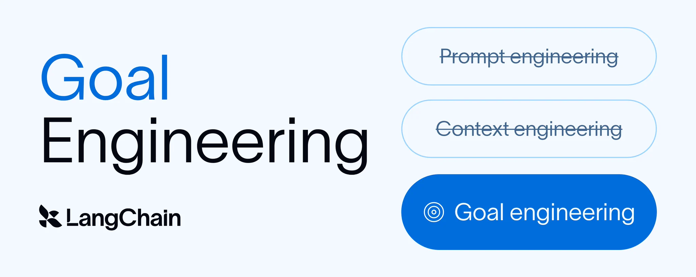
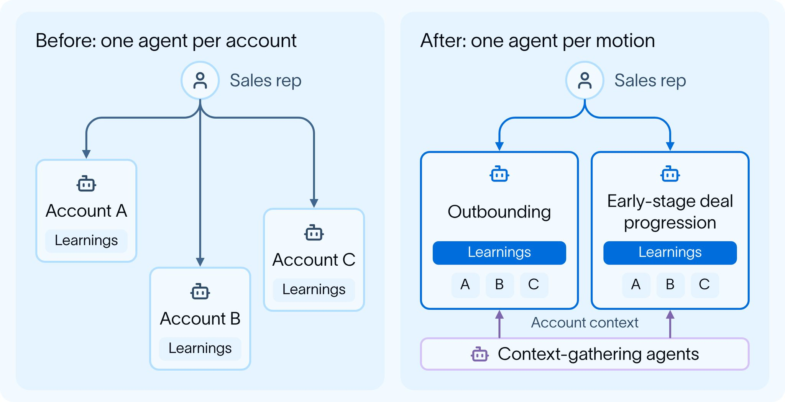
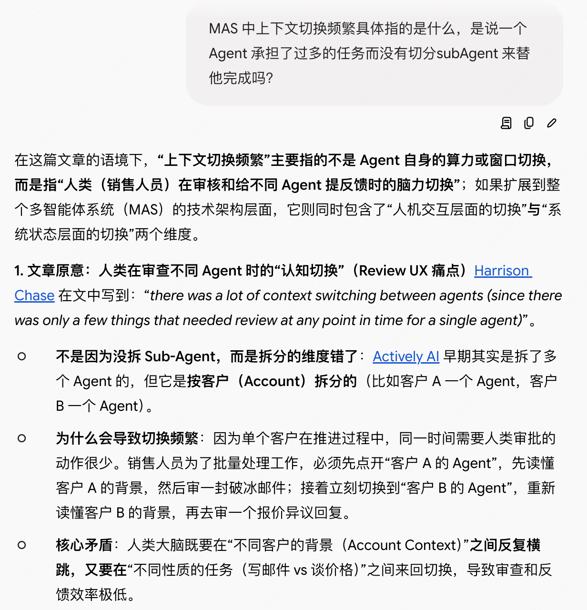
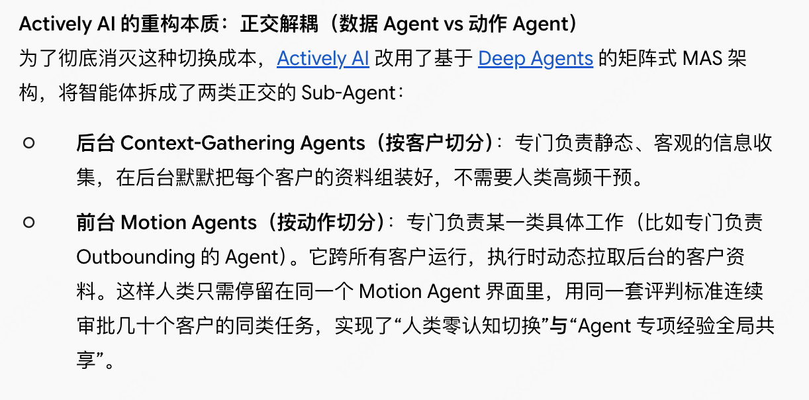
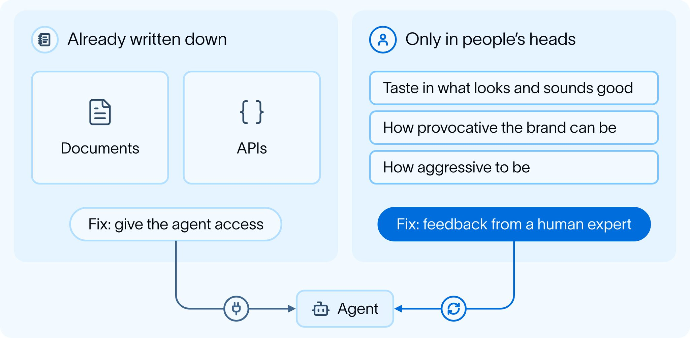
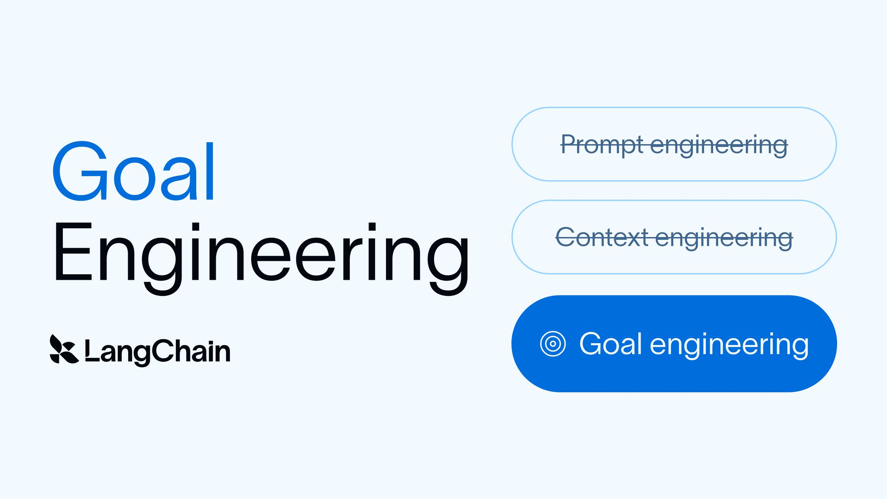

# 观点梳理、思考总结

> 对应原文：[Goal Engineering: How to Design Goals](01-original.md)。本文件以用户的梳理框架为主线，补充逐图要点、Actively AI 公开资料调研和项目侧思考。文章观点、官网公开声明与本文推断分别标注，不混作已验证的代码实现。

## 标题索引

- [一、核心观点：为什么不能按“业务实体边界”划分 Agent？](#一核心观点为什么不能按业务实体边界划分-agent)
- [二、新的演进范式：按 Motion 划分 Agent](#二新的演进范式按-motion工作动作划分-agent)
- [补充辨析：上下文切换与正交解耦](#23-补充辨析上下文切换与正交解耦是否准确)
- [三、Human-in-the-loop 的核心痛点](#三当前人类对-agent-反馈human-in-the-loop的核心痛点)
- [四、Actively AI 实现盘点](#四actively-ai-实现盘点公开资料补充)
- [Actively：社区反馈与公开网络信息](#46-社区反馈与公开网络信息)
- [五、总结与未来趋势](#五总结与未来趋势)
- [六、进一步思考与项目启发](#六进一步思考与项目启发)
- [七、证据边界](#七证据边界)



## 一、核心观点：为什么不能按“业务实体边界”划分 Agent？

在构建面向长期目标的 Agent 时，传统直觉是按**“业务实体边界”**切分，例如在销售场景中让“一个客户/账户（Account）对应一个 Agent”。这种划分有利于集中账户资料，却会在人类反馈和经验复用上形成效率瓶颈：

1. **反馈极度碎片化**：同一 Agent 需要处理写冷启动邮件、处理异议、合同对齐等不同任务。人类审核不同性质的工作时，需要不断切换判断标准和上下文。
2. **经验难以沉淀与泛化**：在一个客户身上纠正出的语气、策略和分寸感，难以自动同步给服务其他客户的 Agent，人类可能被迫重复同一种纠错。
3. **同类工作无法集中审核**：单个账户在任意时刻只有少量待审事项，审核动作分散在不同账户和时间点，难以形成稳定、高效的反馈节奏。

**所以，最优目标边界不一定等于最自然的业务对象边界，而是最有利于形成学习闭环的边界。按“客户”划分符合组织结构，按“motion”划分却更符合反馈和学习规律。**

这里并不是否定账户上下文的价值，而是在区分两个维度：

- **账户边界**适合组织连续、客观、个性化的背景状态。
- **Motion 边界**适合组织可复用的方法、审美、策略和执行经验。

## 二、新的演进范式：按 Motion（工作动作）划分 Agent

文章结合 Actively AI 的案例，提出了更高效的解法：**按“可被高效反馈和持续学习的工作动作/任务类型（Motions）”划分 Agent。**

### 2.1 什么是 Motion 级别的划分？

- **将工作拆成具体业务动作**：例如外呼、早期交易推进、异议处理，而不是让一个 Agent 包揽某个账户的所有工作。
- **同类任务聚合**：销售人员可以在同一审核上下文中集中处理同类产出，例如批量审核外呼话术，减少上下文切换。
- **反馈跨任务复用**：针对某个 Motion 的一次高质量反馈，可以沉淀为该任务类型的共享经验，复用到这个 Motion 正在处理的其他账户，而不是在每个账户里重复纠错。

需要注意，“一次反馈处处生效”是文章强调的架构方向。公开资料没有披露反馈生效的具体时延，也没有证明每次修改都会立即、无审查地同步到全部任务。

### 2.2 架构解法：Motion Agents + Context-gathering Agents

- **前台 Motion Agents**：专注一种动作或任务类型，通过高频、集中、可复用的人类反馈，持续打磨方法论、策略和调性。
- **后台 Context-gathering Agents**：持续组装每个 Account 的客观背景资料，为执行提供客户个性化上下文。
- **按需协同**：Motion Agent 执行具体动作时拉取对应账户背景，同时获得“动作专业性”和“客户个性化”。



**图片要点**：左侧的每个 Account Agent 都各自保存 Learnings，同类经验彼此分散；右侧的 Outbounding 和 Early-stage deal progression 分别聚合自己的 Learnings，并跨 A、B、C 账户复用。底部 Context-gathering agents 为不同 Motion 提供账户上下文。这张图表达的是“执行与学习按动作聚合，背景资料仍按账户组织”。

### 2.3 补充辨析：“上下文切换”与“正交解耦”是否准确？

> 材料来源：用户提供的两张讨论截图，不是原文组成部分。核心道理有效，但部分措辞把“降低成本”放大成了“彻底消灭”，也把分析框架写成了已验证的完整生产架构。





| 截图中的说法 | 判断 | 更准确的表述 |
| --- | --- | --- |
| 上下文切换主要是人类审核时的认知切换，不是 Agent 算力或上下文窗口切换 | **符合原文** | 原文明确说 salespeople 在不同 Account Agents 之间切换，而且每个 Agent 同时只有少量事项需要审核。 |
| 问题不是没有拆 Sub-Agent，而是拆分维度不合适 | **符合原文，也是最关键的一点** | Actively 早期已经按 Account 拆了多个 Agent；问题是审核单元与经验复用单元不匹配，单纯增加 Agent 数量不会解决。 |
| MAS 还包含系统状态层面的切换 | **可以作为延伸讨论，不是原文论点** | 状态同步、记忆检索和跨 Agent 移交确实可能产生技术成本，但需要另找证据，不能借原文这句话直接推出。 |
| Context-gathering Agents 与 Motion Agents 分工 | **原文直接支持** | 后台组装账户上下文，前台 Motions 跨账户执行相似工作；原文称新 goal-oriented agents 基于 Deep Agents。 |
| 两类 Agent 构成完全“正交解耦”的矩阵式 MAS | **是有帮助的分析模型，但不宜当成严格技术事实** | 两者按 Account 和 Motion 两个维度分工，但并非完全独立：Motion 执行依赖 Account 上下文，结果与反馈还会回流。原文也没有使用“正交矩阵”这一术语。 |
| 后台只负责静态、客观的信息 | **“静态”不准确** | 账户资料会持续变化，公开资料还包含推断、决策轨迹与行动结果。应改为“持续更新、相对客观的账户背景”。 |
| 实现“人类零认知切换” | **过度推断** | 同类任务聚合主要减少任务类型和评价标准的切换；审核不同账户、处理异常和跨 Motion 工作时仍有认知成本。 |
| Agent 专项经验全局共享 | **需要限定范围** | 原文支持反馈迁移到同一 Motion 的其他任务，不等于所有 Agent、所有 Motion 或所有租户自动共享；实际同步机制与生效时延未公开。 |

**建议保留的准确版本**：

> Actively 案例的核心不是简单增加 Sub-Agent，而是把“账户上下文如何组织”与“动作执行和经验学习如何组织”分开。Context-gathering Agents 持续维护账户背景，Motion Agents 聚合并跨账户执行同类任务，从而减少人类在审核时的任务类型切换，并提高反馈在同一 Motion 内的复用效率。这不会消除所有账户切换，也不证明经验可以无条件全局共享。

**这个道理迁移到其他 MAS 时，有三个适用条件**：

1. 不同任务之间必须存在可复用的判断标准或隐性经验，否则按 Motion 聚合只会增加调度复杂度。
2. Review UX 必须保留足够的账户证据和个性化上下文，不能为了批量审核把所有任务压成同一种模板。
3. 共享学习必须有明确的作用域、质量门槛和回滚机制，避免一次错误反馈同步扩散到全部账户。

因此，评价这种设计不能只看“拆了多少 Agent”，更应观察**审核耗时、反馈复用率、跨账户错误扩散和最终业务结果**。

## 三、当前人类对 Agent 反馈（Human-in-the-loop）的核心痛点

1. **上下文切换开销大**：任务类型频繁跳跃，让审核过程琐碎且疲惫。
2. **隐性经验难以沉淀**：宝贵经验局限在单次对话或单个客户中，无法高效形成团队级、全局级资产。
3. **Review UX 不佳**：缺少直观、专注、适合批量审查的界面，人类容易只给出敷衍的通过或拒绝，卡住 Agent 的进化瓶颈。
4. **目标定义模糊**：Goal 含糊时，Agent 容易自主脑补目标和评价标准，产出大量不符合业务预期或人类审美的结果。
5. **反馈没有形成闭环**：如果接受、修改、拒绝、实际执行和最终结果没有关联保存，人类反馈就只是一次性操作，而不是可复用的学习信号。



**图片要点**：

- 左侧 Documents 和 APIs 属于已经写下来的显性上下文，主要修复方式是授权 Agent 访问。
- 右侧“什么看起来和听起来好”“品牌可以多激进”“行动应该多进取”等属于人脑中的隐性知识，需要人类专家反馈。
- Review UX 因而不是简单的审批门槛，而是把隐性知识转化为 Agent 可用上下文的接口。

## 四、Actively AI 实现盘点（公开资料补充）

### 4.1 调查范围与结论

本节的“实现”仅指 Actively 官网、产品页和官方技术博客公开展示的产品架构，调查日期为 **2026-11-15**。没有访问其私有代码、客户租户、内部任务轨迹或真实 API 契约。

公开资料最支持的是一个多层系统，而不是单个万能 Agent：

```text
CRM / 邮件 / 通话 / 产品使用 / 外部信号
                    │
                    ▼
       账户上下文、持久记忆、决策轨迹
                    │
             编排与执行 Agents
                    │
       Agent Inbox / Assistant / API / MCP
                    │
          接受 / 修改 / 拒绝 / 执行
                    │
             结果与反馈回流学习
```

这张图是对公开资料的综合抽象，不是 Actively 官方公布的系统部署图。

### 4.2 公开资料能确认的主要组件

| 层次 | 官方公开描述 | 实现含义 |
| --- | --- | --- |
| 数据与上下文 | Agent 综合 CRM、通话、邮件、产品使用和外部来源，持续维护账户状态。[^context-graph] | 输入不只是 CRM 字段，还包括交互历史、信号和决策背景。 |
| 决策轨迹 | 记录 Agent 推荐了什么及原因、销售接受/修改/拒绝了什么，以及随后发生了什么。[^context-graph] | 反馈被放入执行路径，形成“建议 → 人类判断 → 行动 → 结果”的连续记录。 |
| 持久记忆 | 官方称记忆包含 procedural（如何行动）、semantic（什么为真）、episodic（发生过什么）。[^enterprise-lessons] | 不只是临时 RAG；但底层存储、更新和纠错机制没有公开。 |
| Agent 拓扑 | 2026-02 官方文章称 per-account agents 组成 mesh，横向共享学习，并由 orchestration agents 协调客户侧动作。[^mas-scale] | 当时公开架构是账户级持久 Agent 加跨 Agent 编排，不是孤立单 Agent。 |
| 人工审核 | Agent Inbox 中任务由 Agent 通过 tool call 异步入队；人会接受或拒绝，任务随后执行，Agent 会收到生命周期通知。[^human-agent] | 这是公开资料中最具体的反馈闭环实现细节。 |
| 多种交互 | 官方将交互分为 Pull、Push、Ambient、Autonomous；不同模式共享用户级记忆和偏好，Push 可带原上下文转回 Assistant。[^human-agent] | 反馈入口不止聊天，且同一用户偏好可跨界面复用。 |
| 当前产品面 | 当前官网仍强调 Per-Account Agents；Agent Inbox 用于审核已完成工作，Watchtower 聚合风险，API 暴露记忆、决策和策略，MCP 提供账户研究和策略上下文。[^homepage][^inbox][^watchtower][^api][^mcp] | 账户智能作为共享底座，被多个产品表面复用，而不是每个界面各建一套上下文。 |
| 运行时生态 | 最新 Goal Engineering 原文称 motions 构建于 Deep Agents；2026-04 官方称 OpenAI Agents SDK 提供长期运行基础；2026-09 官方称一个 cross-account sales agent 用 Claude Managed Agents 两周建成。[^original][^openai-sdk][^claude-managed] | 可以确认其公开披露过多类 Agent 基础设施，不能据此断言全部生产流量使用同一技术栈。 |
| 交付机制 | Agent PM 和 Forward-Deployed Engineers 会按客户真实销售方式配置部署。[^enterprise-lessons] | 隐性知识不仅靠产品自动学习，也通过高接触交付注入系统。 |

### 4.3 Per-Account 与 Motions 是否矛盾？

公开资料存在两条同时出现的叙述：

- 当前官网和 2026 年多篇官方文章仍强调 **Per-Account Agents**，理由是账户具有连续上下文、稳定目标和跨阶段记忆。[^homepage][^context-graph]
- 2026-11-15 的 Goal Engineering 文章则称第二版目标型 Agent 改为跨账户的 **Motions**，账户资料由后台 context-gathering agents 提供。[^original]

**最合理的统一理解是：Account 负责连续状态与个性化上下文，Motion 负责专业执行与可复用学习。** 两者可以共存，不一定代表“账户 Agent 被全部废弃”。

但这种统一方式属于本文推断，公开资料尚未明确说明：

- 当前生产环境是否已经全面切换到 Motions；
- Per-Account Agent 是仍作为运行时实体存在，还是只保留为产品和记忆抽象；
- Motion 与账户状态之间的调度、隔离、冲突处理和权限边界；
- 官网叙述尚未更新，还是不同客户运行不同版本。

因此，不能简单写成“Actively 已用 Motion 取代 Per-Account”，也不能因为官网仍写 Per-Account 就否定新文章的案例。

### 4.4 反馈闭环如何落地

结合官方文章，可以还原则以下逻辑链路：

1. Agent 持续处理账户信号并更新上下文与记忆。
2. Agent 生成下一步动作或已完成工作，通过 tool call 将任务异步放入 Agent Inbox。
3. 人类基于 urgency、Agent reasoning 和支持材料进行审核。
4. 人接受、修改或拒绝建议，动作随后被执行或终止。
5. 任务生命周期和实际结果回流，形成决策轨迹。
6. 相似模式的经验可跨账户传播；最新文章进一步主张按 Motion 聚合同类反馈。

其中第 2—4 步有明确的官方产品描述；第 6 步的“跨账户传播”是官方架构声明，具体通过共享提示、记忆检索、规则更新、微调还是强化学习实现，公开资料没有给出答案。

### 4.5 不能从公开资料确认的部分

- 具体模型路由、任务调度器、数据库、向量检索或图数据库选型。
- “Context Graph”是否对应某种图数据库；公开文字首先是一种决策轨迹和状态抽象。
- 反馈持久化的数据结构、质量门槛、版本回滚和错误遗忘机制。
- 跨账户学习如何做租户隔离，以及错误反馈如何防止批量扩散。
- Motions 的真实覆盖率、反馈延迟、性能提升和线上业务指标。
- 官网声称的成本、转化率和交付速度数字，尚未在本次调研中做独立验证。

### 4.6 社区反馈与公开网络信息

本节补充于 **2026-11-15**，来源包括 G2、Reddit、Hacker News、TechCrunch、Forbes、Zillow 案例新闻稿和融资法律公告。它们与 Actively 官方博客分开评价。

#### G2：有真实使用反馈，但不能只看总分

G2 当前页面显示 **4.5/5、30 条评论**，其中 19 条五星、11 条四星；评论者样本为 9 家小企业、18 家中型企业、3 家大型企业。这个样本不一定能代表 Actively 所宣传的大型企业部署。[^g2]

**反复出现的正面反馈**：

- 减少账户研究和名单构建时间，帮助销售决定优先联系谁。
- 将账户背景、购买信号和 Salesforce 记录集中起来，减少跨工具查找。
- 2024 年的多条 Organic 评论特别肯定团队响应速度和根据客户反馈改进产品的能力。[^g2-organic]
- 有用户报告更快约到会议、提高 targeted outreach 数量，但这些是个人体验，不是统一口径的对照实验。

**近期评论中的负面或保留意见**：

- 数据和推荐仍需人工核验，存在信息过时、不完整或结果需要手动修改的问题。
- CRM 数据不干净时，推荐准确性会下降；训练和初期理解评分机制需要时间。
- 有评论认为部分 insights 偏表层，希望增强原因解释、预测、仪表盘和分析能力。
- 有 LATAM 销售认为区域公司数据不如美国可靠，并需要额外验证。
- 用户希望改善 CRM/outreach 集成深度和新手引导。

**评论质量限制**：

- 本次页面可见的 10 条近期评论中，9 条标注 `Incentivized / G2 invite`，1 条为 `Organic`；其中 1 条还被 G2 标注为存在卖方或竞争者商业关系、不计入分数。
- 至少两条关于 LATAM 数据的评论文本高度相似，不能把评论条数直接理解为完全独立的证据数量。
- 2024 年 Organic 评论更积极，但对应的是较早的 prospecting/lead-scoring 产品阶段，不能用来证明当前 Per-Account Agents 或 Motions 的效果。

因此，G2 更支持“**研究和优先级排序确实节省时间，但数据、解释和信任校准仍是持续成本**”，不支持“Agent 已经能够无需审核地自主推进收入”。

#### Reddit、Hacker News 与 Product Hunt：直接讨论很少

本次找到的 [Reddit r/SaaS 讨论](https://www.reddit.com/r/SaaS/comments/1r8f48q/has_anyone_used_activelyai_recently/)中，回复者明确表示自己没有使用过 Actively。评论主要质疑整个 AI GTM 品类：

- 很多工具优化发送量而不是转化质量，消息仍有模板感。
- 信号看起来有价值，不等于最终能约到会议。
- 建议用 30 天测试跟踪 booked meetings，并警惕配置和仪表盘工作反而增加复杂度。

这些是有价值的采购评估标准，但**不能写成 Actively 的负面用户实测**。

本次 Hacker News 检索主要找到公司招聘帖，未找到有实质用户讨论的 Actively 产品发布帖；招聘帖提到 eval-driven development、每账户成本下降 50% 等，仍属于公司自述。[^hn] 本次也未找到可确认的 Product Hunt 官方产品页。这里的“未找到”只代表本次公开检索结果，不证明相关内容不存在。

#### 第三方报道、客户新闻稿与融资信息

| 来源 | 新增信息 | 证据限制 |
| --- | --- | --- |
| TechCrunch，2025-04 | 报道其组合使用自研模型与 OpenAI、Anthropic 推理模型；当时累计融资 2250 万美元。公司称 9 个月收入增长 10 倍，但拒绝披露 ARR。记者明确表示其方法是否如宣传有效仍言之过早。[^techcrunch] | 独立媒体报道，但产品效果主要来自创始人陈述。 |
| Forbes，2026-04 | 报道 4500 万美元 B 轮、2.5 亿美元估值；Ramp 将数千万美元新增收入和 AI 驱动交易约 23% 的更高成交率归因于 Actively，Verkada 报告销售生产力提升。[^forbes] | 有具名客户归因，但不是独立审计，也未公开归因模型和对照口径。 |
| Fenwick，2026-04 | 确认 4500 万美元 B 轮由 TCV 和 First Harmonic 共同领投，总融资约 6800 万美元。[^fenwick] | 能佐证融资交易，不证明产品效果。 |
| Zillow 新闻稿，2026-11 | 披露 4 周 A/B pilot、推荐 approval/action rates 80%+、系统集成后一周内上线、24—48 小时出现初期收益；Zillow 还用其 API 构建 Sales Hub。[^zillow] | 来源是 Actively 发布的新闻稿；upgrades 和 churn prevention 有提升但未给具体幅度、样本量或显著性。 |

#### 对原文叙事的外部修正

1. **Motions 解决的是审核和学习的组织问题，不直接解决数据质量。** G2 中的数据新鲜度、区域覆盖和 CRM hygiene 问题，不会因为按 Motion 划分 Agent 自动消失。
2. **持久记忆不等于可信推荐。** 用户仍需要核验、编辑并逐步建立信任，说明 Review UX 还必须提供证据、解释和结果追踪，而不只是批量审批。
3. **高接触交付是实际效果的一部分。** 早期 G2 评论对团队响应的赞扬，以及 Zillow 案例中的 FDE 集成，意味着不能把客户成果全部解释为 Agent 自学习。
4. **外部信号总体偏正面，但独立验证仍薄。** 研究和优先级排序的价值有多来源支持；收入因果、跨账户泛化能力和 Motions 的实际收益仍缺少公开、可复现的数据。

## 五、总结与未来趋势

- **核心结论**：随着 Agent 承担更长期、更主观的工作，目标设计不能只描述结果，还要考虑人类如何审查、反馈如何沉淀、经验在哪里复用。
- **目标工程**：将 Agent 目标与人类最容易审查、最能高效给出高质量反馈的任务形态对齐，通过顺畅的 Review UX，持续提取人脑中的隐性经验。
- **架构方向**：上下文收集与专业执行可以按不同边界组织，账户连续性和 Motion 专业性并不冲突。
- **趋势判断**：原文认为 Prompt Engineering 和 Context Engineering 会消失，Goal Engineering 将长期存在。更审慎的理解是，前两者可能逐步自动化并沉入基础设施，而人的工作重点转向目标、约束、评价和反馈机制。



**图片要点**：图片用删除线弱化 Prompt Engineering 和 Context Engineering，突出 Goal Engineering。它表达的是人类设计杠杆向目标和反馈上移，不应被解读为提示词与上下文在技术上不再存在。

## 六、进一步思考与项目启发

### 6.1 Goal 不只是自然语言描述

一个可执行的 Goal 至少需要同时回答：

- 优化什么业务结果，以及用什么指标判断；
- Agent 负责到哪一段边界，什么情况下停止或升级；
- 谁以什么频率审核什么产出；
- 反馈写到哪里，哪些 Agent 可以复用；
- 如何验证反馈改善了后续结果，而不是引入系统性偏差。

### 6.2 对 build-mas 的直接启发

生成多智能体工作流时，不应只生成角色、步骤和工具，还应把以下内容作为一等设计输入：

1. **上下文分区**：哪些状态按客户、项目或其他业务实体连续维护。
2. **执行分区**：哪些动作具有足够相似性，适合聚合成 Motion。
3. **审核单元**：人类能否成批审核同类工作，并看到理由、证据和影响范围。
4. **学习范围**：反馈仅影响当前任务、当前 Motion，还是整个组织，必须显式声明。
5. **结果回流**：接受、修改、拒绝、执行和业务结果需要关联，才能判断学习是否有效。

### 6.3 最重要的设计约束

方便审核不是唯一目标。若为了提高反馈密度而拆得过细，可能损失端到端结果责任；若为了复用而过度共享反馈，又可能把个体偏好或错误经验扩散到所有任务。正确方向是在**业务结果、上下文连续性、反馈成本和学习复用**之间做显式权衡。

## 七、证据边界

- **原文事实**：仅包括 `01-original.md` 中转录的文章内容与原图。
- **用户框架**：第一、二、三、五部分以用户提供的梳理为主线，并做了结构和表述整理。
- **官方公开声明**：第四部分来自 Actively 官网和官方博客，属于公司自述，不等于独立技术审计。
- **社区与第三方信息**：G2、Reddit、媒体报道和客户新闻稿按来源分别评价；激励评论、旧版产品评论、品类泛论和厂商新闻稿不作为同等级证据。
- **本文推断**：Per-Account 与 Motions 的统一架构、对 build-mas 的启发和工程约束，均不是原文直接结论。
- **未验证实现**：没有进行 Actively 私有代码审查、登录态产品操作、API 实测、客户访谈或业务数据验证。

[^original]: Harrison Chase, Mihir Garimella, Anshul Gupta, [Goal Engineering: How to Design Goals](https://x.com/hwchase17/article/2121635683999883577), 2026-11-15。
[^homepage]: Actively AI, [Product homepage](https://www.actively.ai/)，2026-11-15 访问。
[^context-graph]: Actively AI, [Building Context Graphs for GTM, and Why Salesforce Can’t Do It](https://www.actively.ai/blog/building-context-graphs-for-gtm-and-why-salesforce-cant-do-it), 2026-01-02。
[^human-agent]: Actively AI, [Human-agent collaboration for long-running agents](https://www.actively.ai/blog/human-agent-collaboration), 2025-10-31。
[^enterprise-lessons]: Actively AI, [Future of AI agents: lessons from Actively, Decagon, & Hebbia](https://www.actively.ai/blog/building-agents-for-enterprise-1), 2025-11-11。
[^mas-scale]: Actively AI, [Designing Multi-Agent Systems at Enterprise Scale](https://www.actively.ai/blog/takeaways-from-the-long-game-leadership-summit-and-what-it-means-for-how-we-build-at-actively), 2026-02-23。
[^inbox]: Actively AI, [Agent Inbox](https://www.actively.ai/products/agent-inbox)，2026-11-15 访问。
[^watchtower]: Actively AI, [Watchtower](https://www.actively.ai/products/watchtower)，2026-11-15 访问。
[^api]: Actively AI, [API Platform](https://www.actively.ai/products/api-platform)，2026-11-15 访问。
[^mcp]: Actively AI, [MCP Server](https://www.actively.ai/products/mcp-server)，2026-11-15 访问。
[^openai-sdk]: Actively AI, [Actively Named a Launch Partner for OpenAI's New Agents SDK](https://www.actively.ai/blog/actively-openai-agents-sdk), 2026-04-15。
[^claude-managed]: Actively AI, [Actively Joins Anthropic to Share How Founders Build on Claude Managed Agents](https://www.actively.ai/blog/actively-anthropic-claude-managed-agents), 2026-09-08。
[^g2]: G2, [Actively AI Pros and Cons / Reviews](https://www.g2.com/products/actively-ai/reviews?qs=pros-and-cons)，2026-11-15 访问；页面显示 30 条评论、4.5/5。
[^g2-organic]: G2, [Actively AI earlier organic reviews](https://www.g2.com/products/actively-ai/reviews?page=3)，2026-11-15 访问；主要为 2024 年评论。
[^hn]: Hacker News, [Actively AI hiring post in Ask HN: Who is hiring? October 2025](https://news.ycombinator.com/item?id=45438503)，2025-10。
[^techcrunch]: TechCrunch, [Actively AI raises $22.5M to offer sales ‘superintelligence,’ says AI SDRs failed](https://techcrunch.com/2025/04/02/actively-ai-raises-22-5m-to-offer-sales-superintelligence-says-ai-sdrs-failed/), 2025-04-02。
[^forbes]: Forbes, [Meet The $250 Million Startup Challenging Salesforce With AI Agents](https://www.forbes.com/sites/sofiachierchio/2026/04/28/meet-the-250-million-startup-challenging-salesforce-with-ai-agents/), 2026-04-28。
[^fenwick]: Fenwick, [Fenwick Represents Actively AI in $45M Series B Funding](https://www.fenwick.com/insights/experience/fenwick-represents-actively-ai-in-45m-series-b-funding), 2026-04-28。
[^zillow]: Actively AI 新闻稿，由 StockTitan 转发，[Actively Deploys Proactive AI Agents for Sales Productivity at Zillow Rentals](https://www.stocktitan.net/news/Z/actively-deploys-proactive-ai-agents-for-sales-productivity-at-ahd2l2ehv2h9.html), 2026-11-10。
